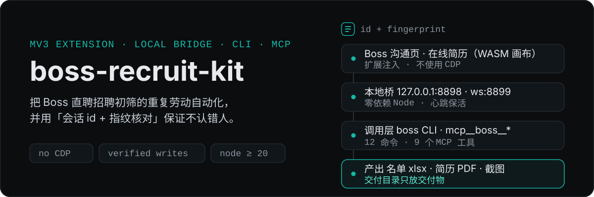
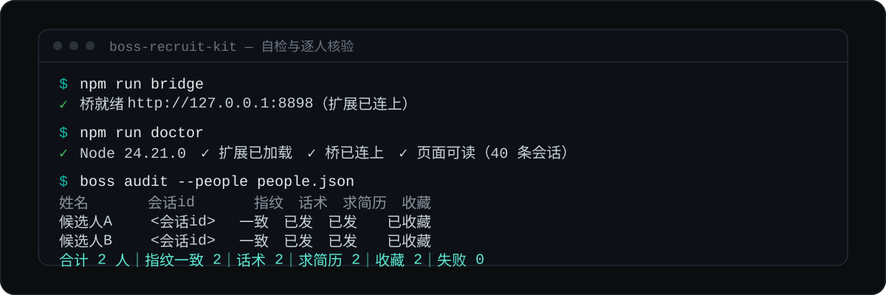
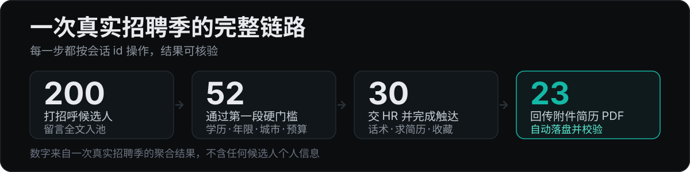

<p align="center">
  
</p>

<p align="center">
  <a href="./LICENSE"></a>
  
  
  
</p>

**在你自己账号里做招聘初筛**时，把「筛人 → 看在线简历 → 触达 → 收简历 → 出名单」这条重复劳动交给命令行和 Agent；同时**不与平台的风控体系正面冲突**——这套工具**完全不使用 CDP/远程调试端口**，而是用「MV3 扩展 + 本地桥」在真实可见的浏览器里操作。

> 非官方项目：与 Boss 直聘及其关联公司无任何关系。所有页面行为描述来自公开可观察的页面现象，仅用于**理解并适配平台误判**。

---

## 它跑起来是什么样

<p align="center">
  
</p>

上面是真实命令与输出形状（候选人信息已替换为占位符）。两次自检 + 一次逐人核验，就是这套工具的日常：

| 验证项 | 命令 | 结果 |
| --- | --- | --- |
| 环境自检 | `npm run doctor` | Node / 扩展文件 / 桥连通 / 扩展已连上 / 页面可读 |
| 冒烟测试（含脱敏自检） | `npm run smoke` | **36 项通过，0 失败** |
| MCP 端到端 | `initialize → tools/list → tools/call` | 返回真实会话数据（9 个工具） |
| 真机链路 | `boss list --limit 5` | 读回真实沟通列表 |

## 一次真实招聘季的链路

<p align="center">
  
</p>

这套工具是在**一次完整的招聘季**里被逼出来的：200 位打招呼候选人里筛出 52 位、精筛后 30 人交 HR 并逐个触达（开场话术 + 求简历 + 收藏）、最终收回 23 份附件简历 PDF。过程中踩的坑全部沉淀成了文档与代码约束。

## 它是什么

四个可独立使用、也可组合的部分：

| 组成 | 目录 | 作用 |
| --- | --- | --- |
| **浏览器通道** | `packages/bridge` | MV3 扩展 + 本地 WebSocket/HTTP 桥（零外部依赖）。页面操作在扩展里做，桥把能力暴露为本地命令 |
| **命令行** | `packages/cli` | `boss` 命令：列会话、按会话 id 访问候选人、抓在线简历、发消息/求简历/收藏、下载附件简历、逐人核验 |
| **MCP 服务器** | `packages/mcp-server` | 零依赖 stdio 实现，把上述能力暴露成 `mcp__boss__*` 工具，供 Agent 直接调用 |
| **接入与打法** | `packages/dsh-plugin`、`skills/`、`docs/` | DSH 配置型插件 bundle、技能文件（SOP + 判据 + 自查）、以及 20 条坑清单等文档 |

## 为什么不一样：三条硬约束

多数"招聘自动化脚本"失败在三个地方。这套工具把答案写进了代码，而不是只写在文档里。

**1. 认人不认名字 —— 会话 id + 指纹核对**

同一个岗位池里重名很常见（实测 710 人里有 5 组同名，甚至有人昵称就叫「求职者」）。按姓名点列表行，消息可能发给另一个人。因此：

- 所有涉及具体候选人的操作**优先用会话 id**（唯一标识）；
- 用姓名定位时，先点开候选人再核对**指纹**（姓名 + 年龄 + 学历 + 年限 + 当前公司及岗位），不一致就**中止**，不猜；
- 搜索命中多个同名时，支持指定「第 N 个」逐个试；
- 批量核验会输出「实际打开到的人是谁」，可逐条审计。

**2. 不信任"点击成功"，只认"会话里真的出现了"**

发消息要同时满足"输入框已清空"与"会话中出现该条消息"；求简历要看到系统消息「简历请求已发送」；收藏**先读状态再点**（避免把已收藏点成取消）。所有写操作幂等，可断点重跑。

**3. 正面处理这类页面真正的技术难点**

- 在线简历是 **WASM 画布**：窗口不在前台时 Chromium 会节流渲染，画布会停在 300×150 占位——所以每步先置前窗口；
- 单次响应过大会让调用卡住：画布**按 2×2 分块、原生分辨率**导出；
- 简历弹层**叠层**会生成"幽灵窄栏浮窗"：开/关简历前后统一清理僵尸弹层；
- 列表是虚拟列表、程序化滚动不加载更多行：定位走"搜索下拉 + 指纹核对"。

以上每条的现象/原因/做法都在 [`docs/PITFALLS.md`](docs/PITFALLS.md)。

## 安装

需要 **Node ≥ 20**（无其它依赖，MCP 服务器也是零依赖）。

```bash
git clone https://github.com/drydraft/boss-recruit-kit
cd boss-recruit-kit
```

**1) 加载扩展**：浏览器打开 `chrome://extensions` → 开启「开发者模式」→「加载已解压的扩展程序」→ 选择 `packages/bridge/extension`。

**2) 起桥**

```bash
npm run bridge            # 本地 HTTP 127.0.0.1:8898 / WS 127.0.0.1:8899
```

**3) 启动浏览器（可见窗口 + 扩展，专用 profile 保留登录态）**

```bash
npm run boss -- browser open --clear-cache
```

> 不要加 `--remote-debugging-port`：站点会检测 CDP 并关闭页面、上报风控。也**不要用无头模式**。

**4) 自检并跑第一条命令**

```bash
npm run doctor                      # 期望：全部通过
npm run boss -- list --limit 20     # 列出沟通列表（会话 id / 姓名 / 职位 / 预览）
```

完整安装说明（含 Windows/macOS 差异、profile、卸载、环境变量表）见 [`docs/INSTALL.md`](docs/INSTALL.md)。

## 命令一览

全局选项：`--json`（机器可读）、`--help`、`--version`。以 `boss --help` 为权威。

| 只读 | 写（可核验、幂等） | 生命周期 |
| --- | --- | --- |
| `list` 列会话 | `send` 发消息（会话核验，`--dry-run` 可预演） | `doctor` 自检 |
| `open` 打开某人看指纹（`--index` 指定同名第 N 个） | `request-resume` 求简历（系统消息核验） | `bridge start\|status` |
| `capture-resume` 抓在线简历（分块图片） | `favorite` 收藏（先读状态） | `browser open` |
| `download-resume` 下载附件简历 PDF | `audit --people people.json` 逐人核验（也可只读核验） | `cleanup` 清理僵尸弹层 |

一个典型的收简历循环：

```bash
npm run boss -- download-resume <会话id> --out-name 候选人A.pdf
npm run boss -- audit --people examples/people.example.json --json
```

## 让 Agent 直接用它

工具面可以挂进任何支持 MCP 的客户端。本仓库自带一个 **DSH Desktop**（作者日常使用）的配置型插件 bundle：

1. 先确保桥与浏览器已按上面步骤启动；
2. DSH 桌面版：**设置 → 插件 → 添加插件**，填入 `packages/dsh-plugin` 的绝对路径，重启应用；
3. 之后模型可直接调用 `mcp__boss__list`、`mcp__boss__download_resume`、`mcp__boss__send_message` 等 9 个工具。

若你的客户端是 Claude Code / Codex 等，也可以直接把 MCP 服务器进程接上：

```bash
node packages/mcp-server/src/server.mjs      # stdio，环境变量 BOSS_BRIDGE_HTTP 可改桥地址
```

把 `skills/` 放进技能目录，模型就同时拿到**做法**（不只是工具）——这套技能是按「路由器 / 核心 / 领域」三层写的，见下一节。

## 技能是怎么组织的：机制与判断分离

**本项目专攻 Boss 直聘招聘端自动化**，不做跨站点通用框架。技能之所以拆成三层，是为了**可维护**：平台改版时只动机制层，招聘口径变化时只动领域层，两边互不污染。

```
skills/
├─ web-automation-router/         路由器 —— 该加载哪些技能（请求类型不清时单独注入）
├─ core-gated-web-automation/     机制 —— 通道/取数/导航/DOM 卫生（怎么在页面上做对）
├─ core-safe-batch-operations/    机制 —— 身份核对/效果核验/幂等/审计（怎么不认错、不谎报）
└─ domain-boss-recruiting/        判断 —— 谁合格、话术怎么说、交付物长什么样（Boss 招聘专有）
```

| 层 | 装什么 | 什么时候需要改 |
| --- | --- | --- |
| **机制层** | 不用 CDP 改走「扩展 + 本地桥」；前台窗口才能让 WASM 画布重绘；画布分块原生分辨率导出；画布绘制型按钮靠色块检测 + 帧内坐标点击；虚拟列表程序化滚动不加载 → 搜索兜底；弹层叠层产生幽灵浮层；开关型控件先读状态；**id + 多属性指纹**核对；**按效果核验**而非点击返回；幂等可重跑 + 审计遍；限流冷却 | 站点改版、浏览器行为变化时 |
| **领域层** | 两段式筛选判据与八维度评分、开场话术、求简历两步、附件简历收集、平台特有选择器与现象 | 招聘口径、话术、交付物要求变化时 |

> 机制层的内容天然与站点无关，所以它也顺手具备了复用价值——但**这不是本项目当前的目标**，现阶段只为让 Boss 招聘这条线长期可维护。

技能采用**四级渐进披露**，让上下文只加载需要的部分：

| 级别 | 内容 | 载入时机 |
| --- | --- | --- |
| 1 | `name` + `description` | 常驻（决定是否触发） |
| 2 | `SKILL.md` 正文 —— 路由表、执行协议、硬门禁 | 触发时 |
| 3 | `references/`、`workflows/` | 用到某个分支才读 |
| 4 | `scripts/`（如 `preflight.mjs`、`batch-ledger.mjs`） | **从不读进上下文**，直接执行 |

`SKILL.md` 只做路由与硬规则，不带知识正文；规则全部**可数可判定**（例如"每次抓取 ≥2 块、单块 ≤64 KB"、"身份未核对则 0 次写操作"、"同一批量重跑必须 0 次新动作"）。架构由 `npm run validate:skills` 机器校验：命名、frontmatter、字数预算、路由表目标是否存在、`SKILL.md` 与 references 是否重复。

## 它不是什么 / 使用边界

- **不是爬虫**：不批量抓取他人数据，只操作你自己账号里的招聘工作流。
- **不做对抗**：不伪造 token、不绕验证码、不用代理池掩盖来源、不修改页面安全脚本；设计目标是**减少平台误判**。
- **不是全自动决策**：评分与结论由你（或 Agent + 你的评分口径）判断，工具体系只负责取数与核验。
- **需要窗口在前台**：这是浏览器的渲染节流行为，不是本工具的缺陷。
- **界面改版会失效**：选择器集中在 `packages/bridge/extension/content.js`，修法见 [`docs/TROUBLESHOOTING.md`](docs/TROUBLESHOOTING.md)。
- **候选人数据是敏感信息**：默认本地保存，不要外传；日志与落盘产物含会话 id，交付前请清理（见 [`docs/OPERATIONS.md`](docs/OPERATIONS.md)）。

## 文档

| 文档 | 解决什么问题 |
| --- | --- |
| [`docs/INSTALL.md`](docs/INSTALL.md) | 安装、起桥、启动浏览器、环境变量、卸载 |
| [`docs/ARCHITECTURE.md`](docs/ARCHITECTURE.md) | 为什么必须「扩展 + 桥」而不是 CDP；四层结构与数据流 |
| [`docs/PITFALLS.md`](docs/PITFALLS.md) | 20 条坑（现象/原因/正确做法）+ 最易踩的 Top 5 |
| [`docs/SOP.md`](docs/SOP.md) | 两段式筛选 SOP、八维度评分、证据硬规则、交付物契约 |
| [`docs/OPERATIONS.md`](docs/OPERATIONS.md) | 日常运维：启停顺序、节奏控制、故障处置、数据隐私 |
| [`docs/TROUBLESHOOTING.md`](docs/TROUBLESHOOTING.md) | 13 个症状的速查表与错误码 |
| [`examples/runbook-screening.md`](examples/runbook-screening.md) | 从 0 到出一份名单的可照做剧本 |
| [`skills/boss-recruiting/SKILL.md`](skills/boss-recruiting/SKILL.md) | 给 Agent 的打法文件 |

## 开发

```bash
npm run check     # 全量语法检查
npm run validate:skills  # 校验技能家族架构（命名/frontmatter/字数/路由表/去重）
npm run smoke     # 冒烟测试（含技能架构与脱敏自检；加 --live 可检查桥与扩展）
npm run package   # 打成可分发的 .tgz / .zip（附 SHA256）
```

改动约定与目录职责见 [`CONTRIBUTING.md`](CONTRIBUTING.md)，版本记录见 [`CHANGELOG.md`](CHANGELOG.md)。

## License

[MIT](LICENSE)。请在遵守平台条款与当地法律的前提下使用；候选人个人信息仅限你的招聘流程内使用并妥善保管。

